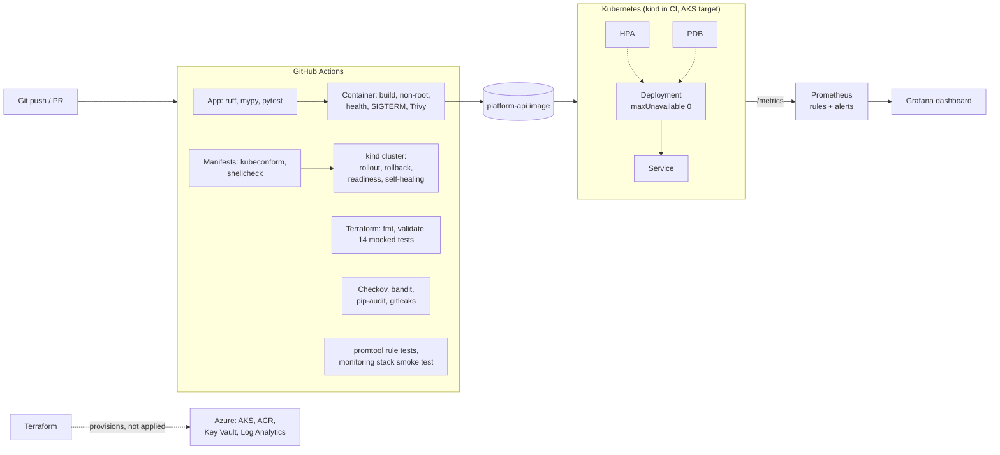

# Cloud Platform Automation

[](https://github.com/imran-basha-data/cloud-platform-automation/actions/workflows/ci.yml)


A small Python service, and everything a platform team builds around it: a hardened container, Kubernetes manifests with zero-downtime rollouts and tested rollback, Terraform for an Azure AKS platform, Prometheus/Grafana monitoring with unit-tested alerts, and a CI pipeline that verifies all of it.

The service is deliberately simple. The engineering is in how it is **packaged, deployed, probed, secured and observed**, and in the evidence that each of those works.

## Architecture



## What is proven, and where

| Capability | Evidence | Where |
|---|---|---|
| Probe semantics, metrics, auth, config validation | 32 unit tests, 98% coverage | CI + local |
| Non-root, read-only, healthy, graceful SIGTERM container | container job assertions | CI + local |
| No fixable HIGH/CRITICAL CVEs in the image | Trivy 0.67.2 | CI + local |
| **Zero failed requests during a rolling update** | 833 requests, 0 failed, both versions served | CI (kind) |
| **Bad release detected and rolled back** | rollout stalls at full capacity (2/2); `rollout undo` restores | CI (kind) |
| Readiness removes a pod from traffic without restart | ready endpoints 2 → 1, 0 restarts | CI (kind) |
| Self-healing | deleted pod replaced | CI (kind) |
| Manifests valid and pass restricted Pod Security | kubeconform strict; server-side dry run; privileged pod rejected | CI + local |
| Terraform valid, logic and guardrails correct | `validate` + 14 `terraform test` runs (mocked provider) | CI |
| IaC security posture | Checkov: Terraform 32/0, Kubernetes 180/0, Dockerfile 97/0 (every suppression has a written reason) | CI + local |
| Alert rules fire when, and only when, they should | `promtool test rules` | CI + local |
| Monitoring stack works end to end | 6-check smoke test against live Prometheus/Grafana | CI + local |
| **Azure deployment** | **not tested: never applied** (no billable resources created) | — |
| HPA scaling under load | not tested (no metrics-server in kind) | — |

## Repository layout

```text
src/platform_api/     FastAPI service: probes, metrics, structured logs, config validation
tests/                pytest suite
Dockerfile            multi-stage, non-root runtime image
k8s/                  Kustomize base + dev/prod overlays, runbook       -> k8s/README.md
scripts/              k8s-e2e.sh (reliability scenarios), verify-monitoring.sh
terraform/            Azure modules, environments, mocked tests         -> terraform/README.md
monitoring/           Prometheus rules + tests, Grafana, Compose stack  -> monitoring/README.md
docs/                 architecture, design decisions, security, testing, troubleshooting
.github/workflows/    CI pipeline (8 jobs)
```

## Quick start

```bash
# Service and tests
python3.12 -m venv .venv && source .venv/bin/activate
pip install -r requirements-dev.txt && pip install --no-deps -e .
pytest --cov

# Container
docker build -t platform-api:local .
docker run --rm -p 8080:8080 --read-only --cap-drop ALL platform-api:local
curl localhost:8080/readyz

# Monitoring stack (API + Prometheus + Grafana), then the smoke test
docker compose -f monitoring/docker-compose.yml up -d --build
./scripts/verify-monitoring.sh

# Kubernetes reliability scenarios on a local kind cluster
kind create cluster --name platform
docker build --build-arg APP_VERSION=1.0.0 -t platform-api:1.0.0 .
docker build --build-arg APP_VERSION=1.1.0 -t platform-api:1.1.0 .
IMAGE_V1=platform-api:1.0.0 IMAGE_V2=platform-api:1.1.0 \
  LOAD_IMAGE="kind load docker-image --name platform" ./scripts/k8s-e2e.sh
```

Terraform usage, and the warning that applying it costs money, are in [terraform/README.md](terraform/README.md).

## Technology

Python 3.12 · FastAPI · Uvicorn · Pydantic Settings · prometheus-client · Docker · Kubernetes 1.33 (Kustomize, HPA, PDB, NetworkPolicy, Pod Security Admission) · kind · Terraform 1.9 + azurerm 4.x (AKS, ACR, Key Vault, Log Analytics, managed identities, workload identity) · Prometheus 3 · Grafana 12 · GitHub Actions · Trivy · Checkov · kubeconform · promtool · bandit · pip-audit · gitleaks

## Known limitations

- **Never applied to Azure.** The Terraform is validated, unit-tested with a mocked provider and scanned, but has not been run against a subscription. Quotas, feature registration (EncryptionAtHost) and regional SKU availability are unverified.
- **No CD to a real cluster.** CI deploys to an ephemeral kind cluster. There is no GitOps controller (Argo CD/Flux) and no registry push.
- **Workload identity wiring is half done.** Terraform creates the identity and federated credential; the ServiceAccount annotation and pod label still have to be added to the prod overlay.
- **HPA scaling is untested** (kind has no metrics-server), and there is no load-test baseline.
- **Alerting stops at Prometheus.** Alertmanager routing (email, Slack, PagerDuty) is not configured.
- **Image tags, not digests**, in the manifests (accepted Checkov finding, documented with its reason).

## Documentation

| Document | Contents |
|---|---|
| [docs/architecture.md](docs/architecture.md) | components, request and deployment flows, failure handling |
| [docs/design-decisions.md](docs/design-decisions.md) | why each major choice was made, alternatives, trade-offs |
| [docs/testing.md](docs/testing.md) | every test layer, what it proves, CI job map |
| [docs/security.md](docs/security.md) | controls by layer and accepted risks |
| [docs/troubleshooting.md](docs/troubleshooting.md) | symptoms, diagnosis, fixes |
| [k8s/README.md](k8s/README.md) | deploy, rollout, **rollback procedure**, maintenance mode |
| [terraform/README.md](terraform/README.md) | modules, environments, identities, guardrails |
| [monitoring/README.md](monitoring/README.md) | metrics, rules, alerts, dashboard |

## Licence

[MIT](LICENSE) © 2026 Mohd Imran Basha
