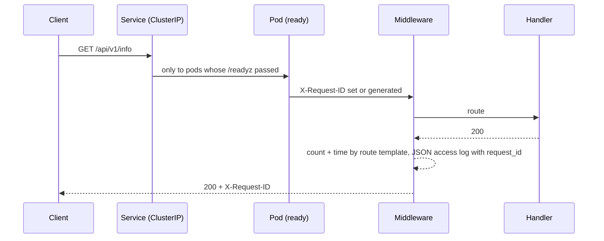
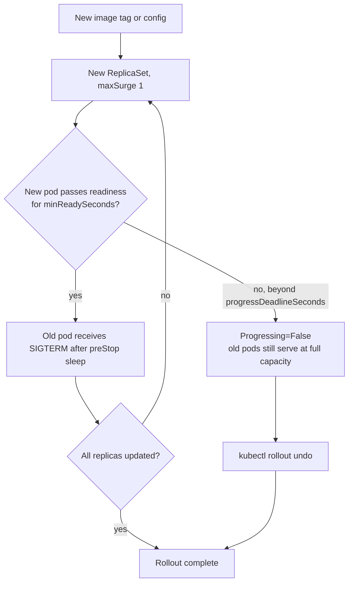

# Architecture

## Components

| Component | Responsibility |
|---|---|
| `platform_api` (FastAPI) | serves the API and exposes liveness, readiness and Prometheus metrics; validates its own configuration |
| Container image | runs uvicorn as PID 1 under uid 10001 on a read-only filesystem |
| Kubernetes (Kustomize) | schedules, probes, scales, rolls out and isolates the service |
| Terraform (Azure) | the target platform: AKS, ACR, Key Vault, Log Analytics, network and identities |
| Prometheus + Grafana | collect metrics, evaluate SLO-style alerts, visualise |
| GitHub Actions | proves every layer on every change |

## Request path

## Probe design

| Probe | Endpoint | Fails when | Effect |
|---|---|---|---|
| startup | `/healthz` | process not up within 60 s | container restarted |
| liveness | `/healthz` | event loop unresponsive (3 × 10 s) | container restarted |
| readiness | `/readyz` | warming up, draining, maintenance, fault injection, dependency down | removed from Service endpoints, **not** restarted |

Liveness deliberately never checks dependencies. If a downstream service is down, restarting every pod fixes nothing and turns a partial outage into a total one.

## Deployment flow

`maxUnavailable: 0` is what keeps serving capacity intact while a bad release stalls. The kind job proves it: available replicas stay at 2/2 and the old version keeps answering.

## Shutdown sequence

1. The pod is marked terminating, and kube-proxy starts removing it from endpoints.
2. `preStop: sleep 5` keeps the container serving while that removal propagates.
3. SIGTERM reaches uvicorn (PID 1). The app marks itself draining, so readiness fails, and in-flight requests finish (up to 20 s).
4. The process exits well inside `terminationGracePeriodSeconds: 30`.

## Azure target (Terraform)

The AKS cluster runs in its own VNet subnet with Azure CNI and Azure network policy. Nodes pull from ACR using a pre-created kubelet identity (AcrPull). The application reads secrets from Key Vault through workload identity federation. Container Insights sends logs and metrics to Log Analytics. See [terraform/README.md](../terraform/README.md).

## Failure handling summary

| Failure | Handling | Verified by |
|---|---|---|
| bad release (never ready) | rollout stalls, capacity kept, `rollout undo` | kind e2e scenario 3 |
| pod crash or deletion | ReplicaSet replaces it | kind e2e scenario 5 |
| instance needs investigation | maintenance mode: out of rotation, still running | kind e2e scenario 4 |
| downstream dependency down | readiness fails, liveness stays green, alert after 5 min | unit tests, promtool |
| error spike / latency regression | `PlatformApiHighErrorRate` / `PlatformApiHighLatency` | promtool |
| node drain or upgrade | PDB keeps ≥ 1 (prod ≥ 2) pods | manifest only (not exercised) |
| invalid configuration | app refuses to start with a clear message | unit tests |
