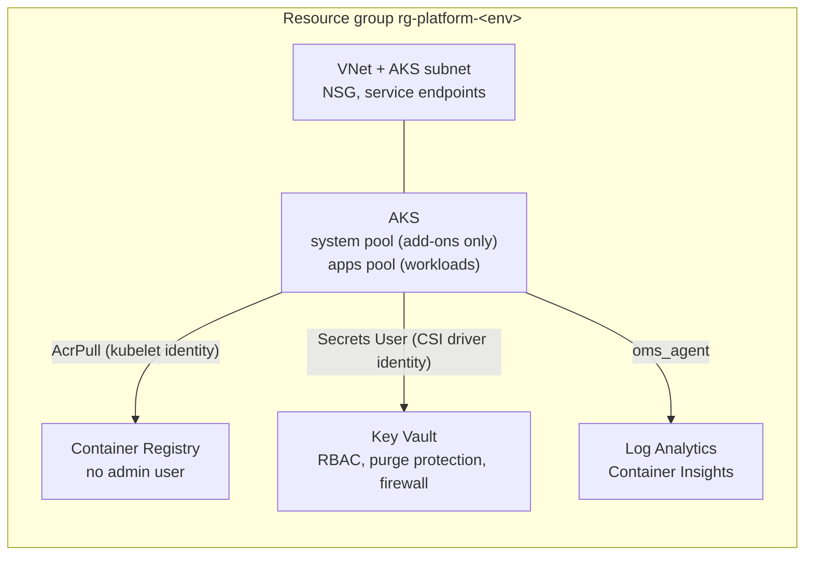

# Azure infrastructure (Terraform)

> **Not applied.** This configuration has been formatted, validated, unit-tested against a mocked provider and statically scanned in CI. It has **never been applied** to a real Azure subscription, so there is no deployed environment and no cost has been incurred. Applying it creates billable resources (AKS nodes, Log Analytics ingestion, ACR, Key Vault). Review `terraform plan` output and get budget approval first.

## What it builds



| Module | Resources | Secure defaults |
|---|---|---|
| `network` | VNet, AKS subnet, NSG | service endpoints for Key Vault and ACR; subnet must be /24 or larger for Azure CNI |
| `monitoring` | Log Analytics workspace | retention 30–730 days, **daily ingestion cap** to bound cost |
| `container_registry` | ACR | admin user and anonymous pull disabled; Premium adds private access, zone redundancy, retention and data endpoints |
| `key_vault` | Key Vault | RBAC authorisation, purge protection, 90-day soft delete, firewall **default Deny** (AKS subnet + operator IPs only) |
| `aks` | AKS cluster + `apps` user node pool | Entra ID + Azure RBAC only (local accounts disabled), workload identity, Azure Policy, network policy, autoscaling, encryption at host, auto patch upgrades, Key Vault CSI driver, authorised API IP ranges, system pool limited to critical add-ons |

The root module grants **AcrPull** to the kubelet identity and **Key Vault Secrets User** to the CSI driver identity, so no registry passwords or secret values are handled.

## Environments

One root module, two variable files, two state files:

| | `environments/dev.tfvars` | `environments/prod.tfvars` |
|---|---|---|
| AKS tier | Free | Standard (uptime SLA) |
| Nodes per pool | 1–2, no zones | 3–6 across zones 1–3 |
| ACR | Basic | Premium |
| Log retention / daily cap | 30 days / 1 GB | 90 days / 10 GB |
| API server access | open (set your IP) | restricted to `authorized_ip_ranges` |

**Plan-time guardrails** (lifecycle preconditions) reject `prod` without authorised IP ranges or without the Standard tier, and any configuration where the autoscaler minimum exceeds the maximum. Variable validation rejects unknown environments, regions outside the UK/EU allow-list, invalid CIDRs, and invalid ACR or Key Vault names.

## Usage

```bash
# One-off prerequisites
az login
az feature register --namespace Microsoft.Compute --name EncryptionAtHost   # for encryption at host
cp environments/dev.backend.hcl.example environments/dev.backend.hcl        # point at your state storage

terraform init -backend-config=environments/dev.backend.hcl
terraform plan -var-file=environments/dev.tfvars -out=dev.tfplan
# Only after reviewing the plan and confirming budget:
terraform apply dev.tfplan

# Wire the outputs into the Kubernetes prod overlay
terraform output -raw acr_login_server
az aks get-credentials -g "$(terraform output -raw resource_group_name)" -n "$(terraform output -raw aks_cluster_name)"
```

## How it is tested (no Azure account needed)

| Check | Command | Covers |
|---|---|---|
| Formatting | `terraform fmt -recursive -check` | style |
| Validation | `terraform init -backend=false && terraform validate` | syntax, provider schema, references |
| Unit tests | `terraform test` | 14 plan-only runs against a **mocked azurerm provider**, covering naming, role assignments, secure settings per module, and rejection of invalid or unsafe input |
| Static security | `checkov -d terraform` | 32 passed, 0 failed, 11 suppressed in code with a written reason |

Mocked plans prove the configuration's *logic*. They cannot prove that Azure accepts every setting together (quotas, feature registrations, regional VM availability). Only a real `plan`/`apply` against a subscription can show that.

## Accepted Checkov findings

Each suppression sits next to the resource it applies to, with its reason. In summary: a private AKS cluster and Key Vault private endpoint would need private DNS and self-hosted CI runners, so authorised IP ranges and a firewall with a subnet service endpoint are used instead. Customer-managed disk keys, ephemeral OS disks and the paid AKS tier in dev are cost or VM-size trade-offs. The ACR geo-replication, quarantine, content-trust and Defender-scanning checks are Premium, preview, deprecated or subscription-level features; images are scanned with Trivy in CI instead.
